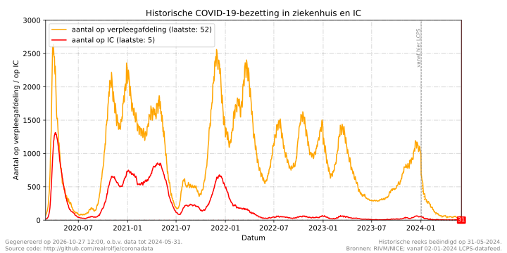
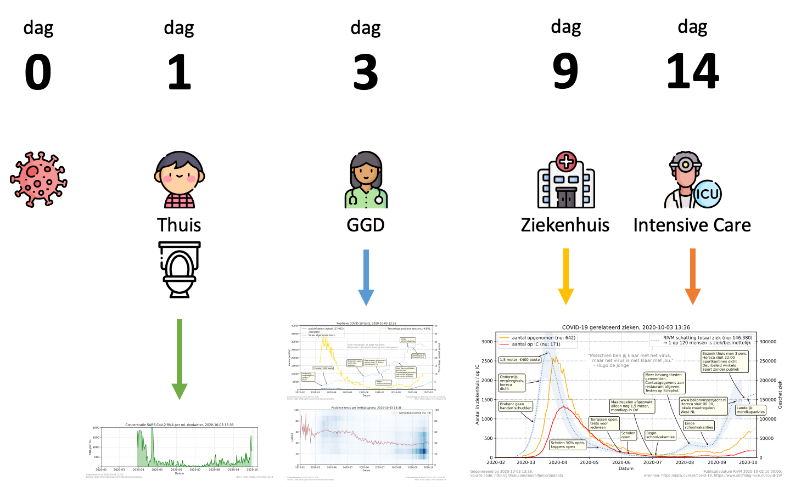

# Coronadata zonder gedoe

Geen smoesjes, je weet het best:
**Houd afstand, werk thuis, was je handen, vermijd drukke plaatsen.**



Alle grafieken zien? Ga naar http://realrolfje.github.io/coronadata

Data in deze grafieken is afkomstig van het 
[RIVM (Rijksinstituut voor Volksgezondheid en Millieu)](https://www.rivm.nl/) en 
[NICE (Stichting Nationale Intensive Care Evaluatie)](https://www.stichting-nice.nl/index.jsp).
De bronadapters en expliciete download-, transformatie-, berekenings- en opslagstappen staan in
[`scripts/pipeline`](scripts/pipeline). `brondata.py` is alleen nog een compatibiliteitslaag voor
de bestaande grafieken. Het downloaden, genereren en publiceren wordt geregeld door
het [update.sh](update.sh) script.

Zie de [Covid dataset](https://data.rivm.nl/covid-19/) 

Voor informatie over hoe RIVM berekenigen maakt en hoe ze data gebruiken, staan veel 
antwoorden op [deze faq pagina](https://www.rivm.nl/coronavirus-covid-19/hoe-berekeningen-bijdragen-aan-bestrijding-van-virus).

Data die niet (direct) bij RIVM beschikbaar is kan vaak in csv of json formaat worden
gevonden bij de [CoronaWatchNL github pagina van Jonathan de Bruin](https://github.com/J535D165/CoronaWatchNL).
Net als hij probeer ik het liefst zo dicht mogelijk bij de bron data te halen dus waar ik dat kan
doe ik dat, om vervuiling en "correcties" uit te sluiten.

Vaak wordt in artikelen het woord "leading indicators" gebruikt. Zonder context is die term
zinloos. Hieronder wordt weergegeven hoe een besmetting verloopt in de tijdlijn (als je
op de intensive care zou komen), en in welke grafieken die data terecht komt. Je kunt hier
bijvoorbeeld zien dat RNA in Rioolwater een "leading indicator" is voor het aantal positieve
tests, en dat positieve tests een "leading indicator" is voor het aantal mensen dat in
het ziekenhuis terecht komt.



In dit overzicht ontbreekt de "Rt grafiek". Deze grafiek wekelijks door het RIVM berekend op
basis van een combinatie van datasets en is sowieso pas achteraf beschikbaar omdat we nu
eenmaal niet van tevoren kunnen vaststellen wie je gaat besmetten.

## RIVM Covid-19 gegevens

Het grootste deel van de gegevens in deze grafieken zijn afkomstig van het RIVM bestand [Covid-19 karakteristieken per casus, landelijk](https://data.rivm.nl/geonetwork/srv/dut/catalog.search#/metadata/2c4357c8-76e4-4662-9574-1deb8a73f724) dat dagelijks wordt bijgewerkt. De data in dit uitgebreide bestand ziet er als volgt uit (twee voorbeeld
records uit het werkelijke bestand):

```json
[
   {
        "Date_file": "2020-08-01 10:00:00",
        "Date_statistics": "2020-02-20",
        "Date_statistics_type": "DOO",
        "Agegroup": "70-79",
        "Sex": "Female",
        "Province": "Limburg",
        "Hospital_admission": "Yes",
        "Deceased": "Yes",
        "Week_of_death": "202012",
        "Municipal_health_service": "GGD Zuid Limburg"
    },
    {
        "Date_file": "2020-08-01 10:00:00",
        "Date_statistics": "2020-07-31",
        "Date_statistics_type": "DPL",
        "Agegroup": "30-39",
        "Sex": "Female",
        "Province": "Overijssel",
        "Hospital_admission": "No",
        "Deceased": "No",
        "Week_of_death": null,
        "Municipal_health_service": "GGD Regio Twente"
    }
]
```

### Beschrijving van de velden in het RIVM bestand:

| Veld | Beschrijving |
|------|--------------|
| Date_file       | Datum en tijd waarop de gegevens zijn gepubliceerd door het RIVM |
| Date_statistics | Datum voor statistiek; eerste ziektedag, indien niet bekend, datum lab positief, indien niet bekend, melddatum aan GGD (formaat: jjjj-mm-dd) |
| Date_statistics_type | Soort datum die beschikbaar was voor datum voor de variabele "Datum voor statistiek", waarbij:|
| | DOO = Date of disease onset : Eerste ziektedag zoals gemeld door GGD. Let op: het is niet altijd bekend of deze eerste ziektedag ook echt al Covid-19 betrof. |
| |  DPL = Date of first Positive Labresult : Datum van de (eerste) positieve labuitslag. |
| | DON = Date of Notification : Datum waarop de melding bij de GGD is binnengekomen. |
| Agegroup | Leeftijdsgroep. |
| | bij leven: 0-9, 10-19, ..., 90+; |
| | bij overlijden: <50, 50-59, 60-69, 70-79, 80-89, 90+ |
| | Unknown = Onbekend |
| Sex | Geslacht: Unknown = Onbekend, Male = Man, Female = Vrouw |
| Province | Naam van de provincie (op basis van de verblijfplaats van de patiënt) |
| Hospital_admission | Ziekenhuisopname. Unknown = Onbekend, Yes = Ja, No = Nee |
| | Vanaf 1 mei 2020 wordt uitgevraagd of de indicatie van de ziekenhuisopname Covid-19 gerelateerd was. Indien dit niet het geval was is de waarde van deze kolom "No". |
| Deceased | Overlijden. Unknown = Onbekend, Yes = Ja, No = Nee |
| Week of Death | Week van overlijden. YYYYMM volgens ISO-week notatie (start op maandag t/m zondag) |
| Municipal_health_service |  GGD die de melding heeft gedaan. |


## Stichting NICE Intensive care gegevens

Van de Stichting NICE worden de volgende bestanden gebruikt:
- [intake-cumulative](https://www.stichting-nice.nl/covid-19/public/intake-cumulative/), het aantal mensen dat ooit met COVID-19 gerelateerde klachten opgenomen is geweest (cumulatief).
- [intake-count](https://www.stichting-nice.nl/covid-19/public/intake-count/), het aantal mensen dat met COVID-19 gerelateerde klachten aanwezig is op de IC.
- [zkh-intake-count](https://www.stichting-nice.nl//covid-19/public/zkh/intake-count/), het totaal aantal mensen op verpleegafdelingen met verdachte of bewezen covid:


Deze bestanden zijn iets eenvoudiger van structuur en zien er als volgt uit:

```json
[
    ...
    {"date":"2020-08-07","value":36},
    {"date":"2020-08-08","value":37},
    {"date":"2020-08-09","value":42},
    ...
]
```

Hierbij is het veld `date` de datum waarop de telling is gedaan, en `value` de waarde van de telling (cumulatieve opnames of aantal patienten op de IC, respectievelijk).

## Rioolwaterzuiverings gegevens

Voor rioolwatergegevens wordt de [Covid-19 Nationale SARS-CoV-2 Afvalwatersurveillance](https://data.rivm.nl/geonetwork/srv/dut/catalog.search#/metadata/a2960b68-9d3f-4dc3-9485-600570cd52b9) gebruikt. Dit bestand bevat per bemonsterde afval-/rioolwaterzuiveringsinstallatie (AWZI/RWZI) in Nederland het gehalte SARS-CoV-2 RNA per milliliter.

De data in dit bestand ziet er als volgt uit:

```json
[
    ...
    {
        "Date_measurement": "2020-08-13",
        "RWZI_AWZI_code": 8022,
        "RWZI_AWZI_name": "Apeldoorn",
        "X_coordinate": 194895,
        "Y_coordinate": 472607,
        "Postal_code": "7317AX",
        "Security_region_code": "VR06",
        "Security_region_name": "Noord- en Oost-Gelderland",
        "Percentage_in_security_region": "1",
        "RNA_per_ml": 479,
        "Representative_measurement": true
    },
    {
        "Date_measurement": "2020-08-13",
        "RWZI_AWZI_code": 12022,
        "RWZI_AWZI_name": "Beverwijk",
        "X_coordinate": 106373,
        "Y_coordinate": 498868,
        "Postal_code": "1948NS",
        "Security_region_code": "VR12",
        "Security_region_name": "Kennemerland",
        "Percentage_in_security_region": "0,435961337",
        "RNA_per_ml": 243,
        "Representative_measurement": true
    }
    ...
]
```

### Beschrijving van de velden in het Afvalwatersurveillance bestand:

| Veld                          | Beschrijving |
|-------------------------------|--------------|
| Date_measurement              | Datum waarop de monstername van het 24-uurs influent (ongezuiverd afval-/rioolwater) monster is gestart (formaat: jjjj-mm-dd). |
| RWZI_AWZI_code                |  Code van rioolwaterzuiveringsinstallatie (RWZI) of afvalwaterzuiveringsinstallatie (AWZI). |
| RWZI_AWZI_name                | Naam van rioolwaterzuiveringsinstallatie (RWZI) of afvalwaterzuiveringsinstallatie (AWZI). |
| X_coordinate                  | Rijksdriehoeksmeting (RD) x-coördinaat van locatie van RWZI of AWZI.  |
| Y_coordinate                  | Rijksdriehoeksmeting (RD) y-coördinaat van locatie van RWZI of AWZI.  |
| Postal_code                   | Postcode van locatie van RWZI of AWZI. |
| Security_region_code          | Code voor de betreffende [veiligheidsregio](https://www.cbs.nl/nl-nl/cijfers/detail/84721NED?q=Veiligheid). |
| Security_region_name          | Veiligheidsregio waarin het verzorgingsgebied van de RWZI zich bevindt. Dit kan meer dan één veiligheidsregio betreffen en dan wordt vermeld welke AWZI/RWZI binnen de betreffende veiligheidsregio vallen. |
| Percentage_in_security_region | Inschatting RIVM met hoeveel procent het verzorgingsgebied van de RWZI zich in de betreffende veiligheidsregio bevindt. Let op: het betreft hier een schatting van het RIVM gebaseerd op CBS data. |
| RNA_per_ml                    | De gemiddelde concentratie SARS-CoV-2 RNA per mL ongezuiverd afval-/rioolwater (influent). Data tot en met 6 september 2020. |
| RNA_flow_per_100.000          | De gemiddelde concentratie SARS-CoV-2 RNA, omgerekend naar dagelijkse hoeveelheid rioolwater (debiet) en weergegeven per 100.000 inwoners.  |
| Representative_measurement    | Tijdsbestek monstername. True = 24-uurs bemonstering van het influent, False = steekmonster (op een moment genomen) van het influent. |


## Installatie van vereiste python libraries op MacOS

Python 3.11 is de ondersteunde versie. De directe dependencies zijn exact vastgezet in
`requirements.txt`.

## Historische build en publiceren

Maak voor lokaal werk bij voorkeur een virtual environment:

```shell
python3.11 -m venv .venv
.venv/bin/python -m pip install -r requirements.txt
```

Een offline render gebruikt de bestaande verwerkte data en doet geen downloads of historische
herberekeningen:

```shell
./render.sh
```

Voer alle tests plus de historische/normalized parity-controles uit met één commando:

```shell
./dev.sh
```

De datastappen zijn afzonderlijk beschikbaar via `scripts/runPipeline.py`. De `update`-opdracht
downloadt iedere actieve bron eenmaal, valideert die, transformeert gewijzigde bronnen, voert
afgeleide berekeningen uit en schrijft daarna pas `daily-stats.json`.

De historische regressietests kunnen apart worden uitgevoerd:

```shell
.venv/bin/python -m unittest discover -s tests -v
```

De update- en publicatiestappen zijn bewust gescheiden. `update.sh` vereist een schone checkout,
fast-forwardt de branch, bouwt de uitvoer en maakt een health report, maar commit of pusht niet.
Controleer de wijzigingen en publiceer ze daarna expliciet:

```shell
./update.sh
./publish.sh
```

`publish.sh` weigert te publiceren bij blokkerende bronfouten of wijzigingen buiten `data/` en
`docs/`. Als er geen gegenereerde wijzigingen zijn, wordt er geen lege commit gemaakt.

## Bronnenregister en bronstatus

[`sources.json`](sources.json) is het machineleesbare register van externe bronnen. Het legt onder
meer eigenaar, URL, formaat, levenscyclus, verwachte actualiteit, velden, eenheden en afnemende
grafieken vast. De levenscyclus maakt onderscheid tussen actieve, bevroren, beëindigde, defecte en
nog onbekende bronnen.

Maak het leesbare statusrapport opnieuw met:

```shell
.venv/bin/python scripts/sourceInventory.py
```

Het resultaat staat in [`SOURCE_STATUS.md`](SOURCE_STATUS.md). Verouderde verplichte actieve
bronnen blokkeren publiceren; een beëindigde historische bron doet dat niet.

Werk de drie actieve epidemiologische bronnen handmatig bij met:

```shell
.venv/bin/python scripts/updateActiveSources.py
```

Elke download gaat eerst naar een tijdelijk bestand. Na HTTP-, content-type-, omvang- en
schemavalidatie wordt gewijzigde inhoud atomair geïnstalleerd en als alleen-lezen snapshot onder
`cache/raw/` bewaard. De genormaliseerde observaties worden idempotent in de lokale SQLite-opslag
geschreven. Ontbrekende ARI-waarnemingen blijven ontbrekend; ze worden niet geïnterpoleerd.

De documentatie per bron staat in [`docs/sources/`](docs/sources/README.md), inclusief de beslissing
om actuele SARI-ziekenhuisgegevens niet aan de historische COVID-bezettingsreeks te plakken.

## Genormaliseerd datamodel

Het versie-1 observatiemodel draait voorlopig naast `data/daily-stats.json`. Het oude bestand blijft
de invoer voor de website en wordt door deze conversie niet aangepast. Bouw de lokale SQLite-versie
en controleer de gelijkheid per metriek met:

```shell
.venv/bin/python scripts/buildNormalizedData.py
.venv/bin/python scripts/checkNormalizedParity.py
```

De database `cache/normalized-v1.sqlite` is een genegeerd, herbouwbaar artefact. De bijgehouden
manifest- en parityrapporten staan onder `data/`. De velden, null-regels, statussen en datumsemantiek
zijn beschreven in
[`docs/architecture/normalized-schema-v1.md`](docs/architecture/normalized-schema-v1.md).

Voor nieuwe bronadapters is SQLite gekozen als herbouwbare tussenopslag achter een algemene
storage-interface. De oorspronkelijke downloads en `data/daily-stats.json` blijven de historische
basis. De onderbouwing en het reproduceerbare rioolwaterexperiment staan in
[`docs/architecture/storage-decision.md`](docs/architecture/storage-decision.md). Voer de pilot uit
met:

```shell
.venv/bin/python scripts/pilotWastewaterSqlite.py
```

## Certificaat probleem oplossen.

Mochten de scripts op macOS SSL certificaat errors opleveren dan zijn de default
certificaten waarschijnlijk niet of niet correct geinstalleerd. De oplossing hiervoor is

```
pip3 install --upgrade certifi
```

Mocht dat niet helpen, dan is het volgende commando een volgende mogelijke oplossing:

```
open /Applications/Python\ 3.11/Install\ Certificates.command
```

Voor meer informatie over dit probleem zie https://stackoverflow.com/a/62374703/3540161

## Credits

Deze repository is ontstaan uit een soort weddenschap die in maart ontstond waarbij we
probeerden te voorspellen "hoeveel word het morgen?". Die uitlatingen moesten natuurlijk
steeds nauwkeuriger en steeds professioneler, er ontstond een COVID-19 groep op Telegram
met meer data nerds, en er werden (simpele) modellen gemaakt in Excel die steeds grotere
vormen aannamen.

Bij het werken aan deze sheets was het natuurlijk belangrijk om verse data en kennis te
hebben, want voor ieder model geldt: Garbage in is garbage out. Gelukkig maakt het RIVM
deze data beschikbaar, eerst in HTML/Tweet vorm, maar al snel in json en csv files. Het
kopieren naar excel werd steeds lastiger (steeds grotere datasets), en daarom ben ik zelf
overgestapt naar python, matplotlib, numpy en een server die dat 3x daags allemaal update.

Een speciale vermelding gaat toch wel naar Jaap van Dissel, die in de informatiesessies
van soms meer dan 2 uur geduldig aan de ministers in de collegezaal en ons als publiek
uitlegt hoe alles inelkaar zit, en wat de nieuwe inzichten zijn. Hartelijk dank voor de
uren college en prachtige rustige antwoorden op vragen waar ik zelf het geduld niet voor
zou hebben gehad.

In Augustus en September heb ik via Twitter veel informatie en pointers gekregen van
het RIVM, en het ministerie van Volksgezondheid. Daarvoor speciale dank aan Eveline, die
mijn vragen doorgaf aan de onderzoekers, en mij wees op nieuwe datasets en info.

Ondanks alle input en moeite is deze repository natuurlijk ook maar gewoon een weergave van
beschikbare data, met wat amateuristische berekeningen van mijn hand. Ik heb geprobeerd
duidelijk aan te geven wat "echte data" is, en wat "berekend" is, ik hoop dat jullie er
iets aan hebben.

Van Open Source wordt iedereen beter, en als je ergens over moppert, moet je er ook iets
aan proberen te doen.

Have fun,
Rolf
